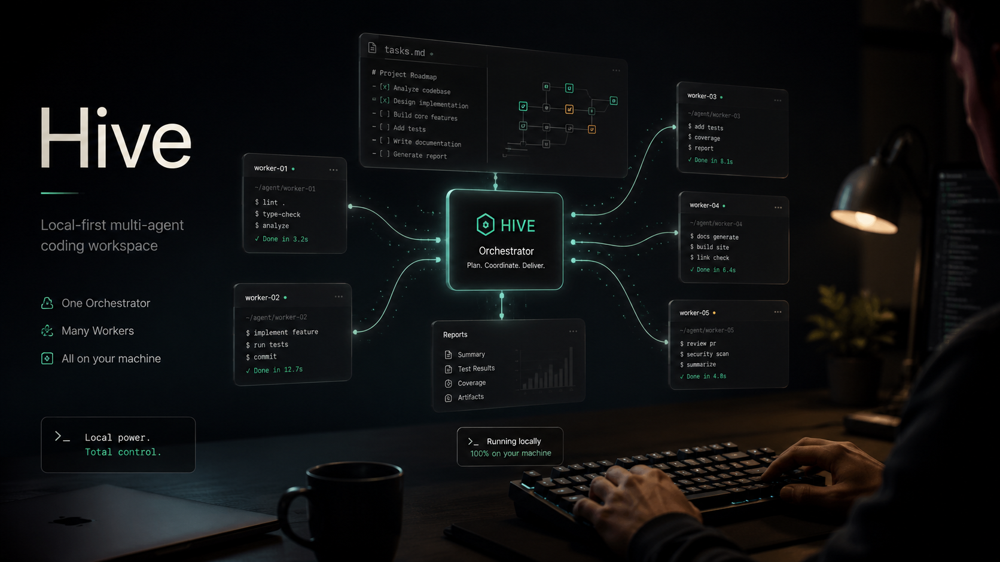

> Development, issues, pull requests, and releases are maintained in this repository, including the gateway source. The default branch can contain unreleased work; npm installs the latest published release. See [CONTRIBUTING.md](CONTRIBUTING.md) and [the release guide](docs/release.md). The BSL license is unchanged.

<p align="center">
  
</p>

# Hive

<p align="center">
  
</p>

**Run Claude Code, Codex, Gemini, OpenCode, Qwen, Pi, and other CLI agents as a visible local team.** Hive gives you one browser workbench where an
Orchestrator plans and delegates while workers implement, review, test,
research, and report back — all as real PTY processes on your laptop.

Use Hive when one agent is not enough, but a pile of terminal windows is not a workflow.

[](https://www.npmjs.com/package/@tt-a1i/hive)
[](https://github.com/tt-a1i/hive/actions/workflows/release.yml)
[](https://hivehq.dev)
[](https://nodejs.org/)
[](./LICENSE.BSL)
[-lightgrey.svg)](#platform-support)

🌐 **Website**: [hivehq.dev/en/](https://hivehq.dev/en/) · [中文](https://hivehq.dev/)

English · [简体中文](./README.zh.md)

> Hive is local-first, runs on `127.0.0.1`, and is intended for anyone who
> already runs CLI agents. The latest stable release is on
> [npm](https://www.npmjs.com/package/@tt-a1i/hive) and the badge above resolves
> to it.

<p align="center">
  
</p>

## Why Hive

CLI agents are powerful, but coordinating several of them manually is
awkward:

- Long-running sessions are spread across terminals.
- Splitting work across agents — implementation/review/testing,
  research/drafting/fact-checking, or any other division of labor — needs a
  routing layer you don't have.
- Worker progress disappears into scrollback.
- Restart recovery depends on each CLI's native session behavior.

Hive adds the coordination layer without replacing the CLIs. The Orchestrator
is a real `agy` / `claude` / `codex` / `opencode` / `gemini` / `hermes` /
`qwen` / `pi` process, not a scripted PM. Workers are real CLI agents too. Hive
injects a small `team` command into their shells, so they can dispatch,
report, and keep a shared markdown task graph at `<workspace>/.hive/tasks.md`.

## Use It For

**Ship a PR with a reviewer in the loop**

Ask the Orchestrator to implement a change, spawn a reviewer, and keep the
review feedback visible before you merge. The coder edits; the reviewer checks
the diff; the Orchestrator decides what still needs work.

```text
Ship the settings search bugfix. Use one worker to implement it and another to
review edge cases before the final report.
```

**Run a parallel bug hunt**

Give several workers separate slices of a flaky behavior: one reads the server
path, one checks the UI path, one looks for regressions in recent commits. You
watch the reports converge instead of juggling terminals.

```text
Find why mobile reconnect sometimes stalls. Split server transport, browser UI,
and recent commit history across separate workers.
```

**Research, draft, and fact-check without losing the thread**

Let one worker gather sources, another draft, and a reviewer check claims. The
task graph and reports stay in one workspace, so the handoff is inspectable
instead of trapped in chat scrollback.

```text
Write a technical note on our release flow. Have one worker collect evidence,
one draft, and one verify every command and file reference.
```

## Try the demo first

Don't have an agent CLI installed yet? Run `hive`, open the printed URL, and
click **Try Demo** in the first-run wizard. The demo is a pure client-side
replay: a fake terminal types through planning, `team spawn`, `team send`,
worker reports, and `.hive/tasks.md` checkoffs. It does not need network
access, an installed CLI, or any sign-in, and it never calls demo workspace
server routes.

## Quick Start

Prerequisites:

- Node.js 22.18+ (22.x), or 24+.
- At least one supported agent CLI installed, authenticated, and available on
  `PATH`.

Install and start Hive:

```bash
npm install -g @tt-a1i/hive
hive
```

Hive uses Node's built-in SQLite and platform-specific PTY binaries. First
installation works with npm 12 defaults and with `--ignore-scripts`; no build
tools or script approvals are required. Keep optional dependencies enabled so
npm can install the binary for your platform.

Open the printed local URL, usually `http://127.0.0.1:9483/`. Use
`hive --port 0` when you want Hive to ask the OS for any free local port.

To upgrade in place:

```bash
hive update
```

`hive update` installs the new version with `--ignore-scripts`, preserving the
original npm prefix. It never changes your npm script policy.
After npm exits 0 it probes SQLite and a short-lived PTY in a fresh process
using this Hive CLI Node (`process.execPath`). The npm child gets that Node
directory prepended on PATH for the update only; a custom `--prefix` is the
package target and is not required to contain a Node binary. It will not print
a successful update if that probe fails.
Restart any in-flight Hive process to pick up the new version. If you installed
Hive with pnpm or yarn, upgrade through the same package manager — otherwise
the new npm copy will shadow your existing install.

Install Hive as an app (optional):

Open `http://127.0.0.1:9483/` in Chrome, Edge, or Brave and click the install
icon at the right edge of the browser's omnibox. The PWA launches in its own
dock-anchored window without browser chrome and shows **Add Workspace** /
**Try Demo** shortcuts from the dock right-click menu. Firefox and Safari
currently don't implement the install-prompt protocol, so the omnibox icon
only appears in Chromium-based browsers.

The Hive daemon must still be running for the PWA to do anything; if the
runtime isn't reachable when you launch the app, you'll see a "Hive runtime
is not running" page that auto-reloads once `hive` is back on `127.0.0.1`.
The PWA install scope is keyed by origin, so `hive --port 9484` installs as
a separate app from `hive --port 9483`. To uninstall, visit `chrome://apps`,
right-click the Hive tile, and choose **Remove from Chrome…**.

Hive asks the browser to confirm before closing the tab or PWA window so an
accidental close shortcut (Cmd-W on macOS, Ctrl-W on Windows/Linux) doesn't
drop your session. Modern browsers gate that prompt on prior page interaction
— if you open the PWA and immediately press the close shortcut without
clicking or typing anywhere first, it still closes cleanly. That's a browser
policy, not a Hive bug.

First-run flow:

1. Create a workspace from a project folder.
2. Choose an Orchestrator preset.
3. Hive creates `<workspace>/.hive/tasks.md`, starts the Orchestrator PTY, and
   injects the internal `team` command into the agent session.
4. Add workers from the Team Members panel.
5. Ask the Orchestrator to delegate work. It sends tasks with
   `team send <worker-name> "<task>"`; workers report back with `team report`.

For stronger automation, enable the experimental **Workflows** toggle in
settings. The Orchestrator can then author and run multi-agent workflows that
fan out across implementation, review, testing, or other stages. The topbar
**Workflows** panel shows runs, phase results, logs, schedules, and stop
controls. The same panel also lets you choose which CLI workflow-created
agents use by default and which CLIs they are allowed to use.

## How It Works

```text
Browser UI on 127.0.0.1
  tasks, team, terminals, reports
          |
          | HTTP + WebSocket
          v
Hive runtime
  SQLite metadata, PTY lifecycle, task dispatch
          |
          +-- Orchestrator PTY
          |     can call: team send, team list, team report
          |
          +-- Worker PTY
          |     can call: team report
          |
          +-- Worker PTY
                can call: team report

Workspace task graph:
  <workspace>/.hive/tasks.md
```

Three details matter:

- Agents are real CLI processes, not simulated subagents.
- `team` is injected only inside Hive-managed agent sessions by prepending the
  package's internal bin directory to `PATH`; it is not installed as a global
  command.
- The task graph is a markdown file in the workspace, so you can inspect or
  edit it outside the app.

## Agent Presets

| Preset | Command expected on `PATH` | Default bypass mode | Session resume |
| --- | --- | --- | --- |
| Antigravity CLI | `agy` | `--dangerously-skip-permissions` | `--conversation <session_id>` |
| Claude Code | `claude` | `--dangerously-skip-permissions`, `--permission-mode=bypassPermissions` | `--resume <session_id>` |
| Codex | `codex` | `--dangerously-bypass-approvals-and-sandbox` | `resume <session_id>` |
| OpenCode | `opencode` | Config-driven in `~/.config/opencode/opencode.json` | `--session <session_id>` |
| Gemini | `gemini` | `--yolo` | `--resume <session_id>` |
| Hermes | `hermes` | `--yolo` | `--resume <session_id>` |
| Qwen Code | `qwen` | `--approval-mode yolo` | `--resume <session_id>` |
| Pi | `pi` | `--approve` | Session id capture not wired yet |
| Cursor CLI | `cursor` | `--force` | Session id capture not wired yet |
| Grok Build | `grok` | `--always-approve` | Session id capture not wired yet |
| [Kimi Code](https://www.kimi.com/code/docs/en/kimi-code-cli/guides/getting-started.html) | `kimi` | `--auto` | Session id capture not wired yet |
| Custom | Any executable | User configured | User configured |

Hive does not install these CLIs for you. Install and authenticate them in the
same shell environment you use to start Hive.

### CLI support tiers

| Tier | CLIs | Commitment |
| --- | --- | --- |
| Tier 1 | Claude Code, Codex | Minimum compatibility report in CI (`pnpm compat:cli:report`): Node 22.18+, built-in SQLite, prebuilt PTY, and CLI version detection when installed. |
| Tier 2 | Gemini, OpenCode, Qwen Code, Hermes, Pi, Cursor CLI, Grok Build, Antigravity CLI, Kimi Code | Built-in presets and manual smoke coverage; upstream CLI changes may require user reports before Hive catches up. |
| Custom | Any executable | User-maintained command, args, and auth behavior. Hive preserves the PTY/session wrapper but cannot promise CLI-specific compatibility. |

For a wrapper around a supported CLI, keep that CLI's preset selected when entering
the custom startup command. Hive uses the preset to deliver startup instructions
and handle the interactive prompt. An unrecognized executable without a matching
preset can run in a PTY, but automatic role/startup guidance is not injected.

## What Hive Provides

- Workspace sidebar for switching between local projects.
- Orchestrator and worker terminals backed by real PTYs.
- Add Worker flow with role presets for coder, reviewer, tester, and fully
  custom prompts and commands — wire any CLI agent into the role you need.
- Workflows (experimental, off by default): the Orchestrator can run
  multi-stage, multi-agent workflows while Hive shows runs, logs, results,
  schedules, and stop controls in the Workflows panel.
- Workflow CLI policy: choose the default CLI for workflow-created agents and
  restrict which CLIs workflow scripts may launch.
- `.hive/tasks.md` editor with external-file conflict handling.
- Background PTY preservation and best-effort native session resume for presets with
  configured session capture.
- A What's New dialog after upgrades with curated release highlights.
- Local SQLite metadata under `%APPDATA%\hive` on Windows and `~/.config/hive`
  on macOS / Linux by default, or `$HIVE_DATA_DIR` when set.

Hive does not provide sandboxing, multi-user auth, or any bundled agent
model. It coordinates the CLIs you already run locally.

## Remote Access (optional, off by default)

If you want to reach your running Hive from your phone while you're away,
turn on the optional **Remote access** feature. Once enabled, a phone browser
logs in at a gateway with GitHub or Google, pairs once with the desktop, and
then reaches the **full** Hive web UI over an end-to-end encrypted tunnel — a
paired phone is a trusted device with the **same authority** as the local
browser.

A few things to be clear about:

- **Off by default.** With it off there are no outbound connections and
  nothing listening — behavior is exactly what it is today.
- **Requires a gateway.** The tunnel is relayed through a gateway (your
  local daemon dials out to it — no open ports, no router changes). The
  gateway URL is configurable: **self-host** a Cloudflare Workers gateway,
  or point at one that's already deployed. There is **no turnkey hosted
  service** — you stand the gateway up yourself.
- **Data and execution stay local.** The gateway only does identity (OAuth
  login) and routing; it never sees plaintext, only relays ciphertext. If the
  gateway is down, everything on local `127.0.0.1` keeps working.
- **End-to-end encrypted.** Every data frame between the phone and the daemon
  is end-to-end encrypted; the gateway sees only ciphertext and routing
  headers. The honest caveat: the phone's crypto code is served by the gateway
  (the classic limit of web-delivered E2E, like Proton or WhatsApp Web),
  mitigated by SRI, versioned bundles, and PWA caching that forms a TOFU
  baseline. We don't claim "secure even if the gateway is compromised."
- **Trust root stays on the desktop.** Pairing a new device must be confirmed
  in person at the computer (a desktop dialog plus a 6-digit SAS check); a
  paired phone can't approve new devices on its own. Devices can be revoked at
  any time.

See [docs/remote-access.md](docs/remote-access.md) for the full enable,
login (`hive remote login`), pairing, revoke, and self-host-gateway walkthrough.

## Platform Support

| Platform | Status | Notes |
| --- | --- | --- |
| macOS | Tier 1 | Main development and release verification target. |
| Linux | Tier 1 | CI verified. Native folder picking expects `zenity`; manual path entry works without it. |
| Windows | Tier 2 | Native, no WSL required. CI runs `pnpm test:windows`, packaged-install smoke, and `pnpm compat:cli:report` on `windows-latest` to catch SQLite / PTY runtime failures. Workspace selection uses Hive's in-browser server filesystem picker by default, starting at "This PC" so other drives are visible; the package includes `team.cmd`. |

Supported binary targets are macOS, Windows, and glibc Linux on x64 or arm64.
Use Node.js 22.18+ (22.x), or 24+. SQLite is provided by Node; PTY binaries are
installed as ordinary platform packages without compiling on your machine.
Alpine/musl and other architectures are not currently supported.

## Safety Model

Hive is a local development tool, not a hosted service.

- The runtime binds to `127.0.0.1`. Do not expose the Hive port through a public
  tunnel, reverse proxy, or shared network interface.
- Built-in presets intentionally use each CLI's non-interactive or bypass mode
  where available. Treat workers as able to run arbitrary shell commands inside
  the selected workspace.
- Open only trusted workspaces. A worker has the same filesystem access as the
  shell account running Hive.
- Agent tokens are session scoped, generated by the local runtime, injected into
  agent process environments, and not intended as internet-facing credentials.
- Hive has no multi-user authentication boundary. Treat same-machine processes
  that can reach the local port as trusted local access.
- The browser UI token is a local session guard, not protection against other
  processes already running as your OS user.

Read [SECURITY.md](SECURITY.md) before using Hive with sensitive repositories.

## Data Locations

| Data | Location |
| --- | --- |
| Runtime metadata | Windows: `%APPDATA%\hive`; macOS / Linux: `~/.config/hive`; or `$HIVE_DATA_DIR` |
| Workspace tasks | `<workspace>/.hive/tasks.md` |
| Internal `team` command | Packaged under `dist/bin/`, injected into PTYs |
| Web UI assets | Served by the runtime from the packaged `web/dist` build |

## Troubleshooting

**Agent CLI not found**

Check that the selected command is installed, authenticated, executable from the
same shell, and available on `PATH`.

**Port already in use**

Start Hive with another local port:

```bash
hive --port 4020
```

**A platform binary is missing**

Check `node --version` (22.18+ on 22.x, or 24+) and install on a supported platform.
Do not use `--omit=optional` or copy `node_modules` between operating systems;
the PTY package is selected for the installation host. Reinstall Hive with
optional dependencies enabled. No installation scripts need to be approved,
and no C++ compiler is required.

If an older installation reports missing `better-sqlite3` bindings, install
the current Hive release with npm. Existing Hive SQLite data stays in place.

**Folder picker does not open on Linux**

Install `zenity`, or paste the workspace path manually.

**Folder picker on Windows**

Hive uses the in-browser server filesystem browser by default on Windows
instead of launching the PowerShell native folder picker. This avoids the
system dialog getting hidden behind the browser window. The browser starts at
"This PC" and lists accessible drives, so `C:\`, `D:\`, and other drives are
reachable. If the target directory is not visible in the browser list, expand
"Advanced: paste path" and enter the absolute path directly.

**Tasks file conflict banner appears**

Hive detected a newer `.hive/tasks.md` on disk. Use `Reload` to accept the file
from disk, or `Keep Local` to keep the editor contents and save again.

**Worker appears stuck in `working`**

Hive does not guess task completion from process activity. Workers move back to
`idle` when they call `team report`. If a worker is blocked, stop or restart it
from the UI.

## Development

```bash
pnpm install
pnpm dev
```

Development mode runs the runtime on `127.0.0.1:9483`; Vite runs on
`127.0.0.1:5180` and proxies API and WebSocket traffic to the runtime.

Useful checks:

```bash
pnpm check
pnpm build
pnpm test
```

Production-style local run:

```bash
pnpm build
node dist/src/cli/hive.js --port 9483
```

The production server serves the built web UI directly. No Vite server is
needed after `pnpm build`.

## Release

Maintainer dry run:

```bash
pnpm release:dry
```

See [docs/release.md](docs/release.md) for the full tagged release checklist,
including manual Windows smoke steps.

Tag pushes matching `v*` run the GitHub Actions release workflow. The workflow
verifies macOS, Ubuntu, and Windows, then publishes to npm with `NPM_TOKEN`.

## Status

Hive is in alpha. The core flow is usable today; current work focuses on
polishing the multi-agent collaboration workflow, Windows support, and clearer
orchestration observability. Try it out and open issues — feedback shapes what
gets prioritized next.

## Search collaboration history

Hive stores workspace collaboration messages and reports. Use `team recall` to search the history, and verify facts that may have changed before relying on them.

## A different form factor: squad

If you'd rather have **pure CLI, zero background process, and the ability to
run on a remote SSH box**, [squad](https://github.com/mco-org/squad) takes the
same idea down a different path — SQLite as the protocol layer, one terminal
per agent. The two projects don't replace each other; pick by workflow:

- **Hive** — visual workbench, one-click restart, workspace sidebar, easier to demo to a team
- **squad** — lives in tmux, SSH remote dev, no extra background process, Windows servers

## Acknowledgements

The built-in template marketplace ships snapshots of two community-maintained prompt libraries, both distributed under their upstream MIT licenses:

- English (used when the UI is set to EN): [`msitarzewski/agency-agents`](https://github.com/msitarzewski/agency-agents)
- Chinese (used when the UI is set to 中文): [`jnMetaCode/agency-agents-zh`](https://github.com/jnMetaCode/agency-agents-zh)

Upstream content is mirrored verbatim, license files are kept under `vendor/marketplace/<lang>/LICENSE`, and snapshots are refreshed by `pnpm sync:marketplace` before each Hive release.

## License

Hive is **source-available under the Business Source License 1.1 (BUSL-1.1)**. It is **not** open source as defined by the OSI, and we don't describe it as such.

### License FAQ

**Why isn't it OSI open source?** BUSL-1.1 places one restriction on production use (next answer), which keeps it outside the Open Source Definition — the BUSL license text itself states it "is not an Open Source license". Rather than blur that line, we say source-available plainly.

**Does it affect personal or team use?** No. The Additional Use Grant in [LICENSE.BSL](LICENSE.BSL) explicitly allows production use; the only carve-out is offering Hive to third parties — hosted or embedded, on a paid basis or under any other revenue-generating arrangement (including paid support) — in a way that competes with Hive's multi-CLI-agent orchestration product. Personal use, internal deployment within your organization, embedding into a non-competitive product, and non-commercial forks are all fine.

**Will it become open source later?** Yes. Each version converts to the **Apache License 2.0** on the Change Date (2030-05-16) or four years after that version's first public release, whichever comes first.

See [LICENSE.BSL](LICENSE.BSL) for the exact terms. Forks and redistributions must preserve [NOTICE](NOTICE), [LICENSE.BSL](LICENSE.BSL), and the applicable license files. The Hive name, logo, and visual identity are not licensed by the source license; see [TRADEMARK.md](TRADEMARK.md) for brand usage boundaries.
